<p align="center">
  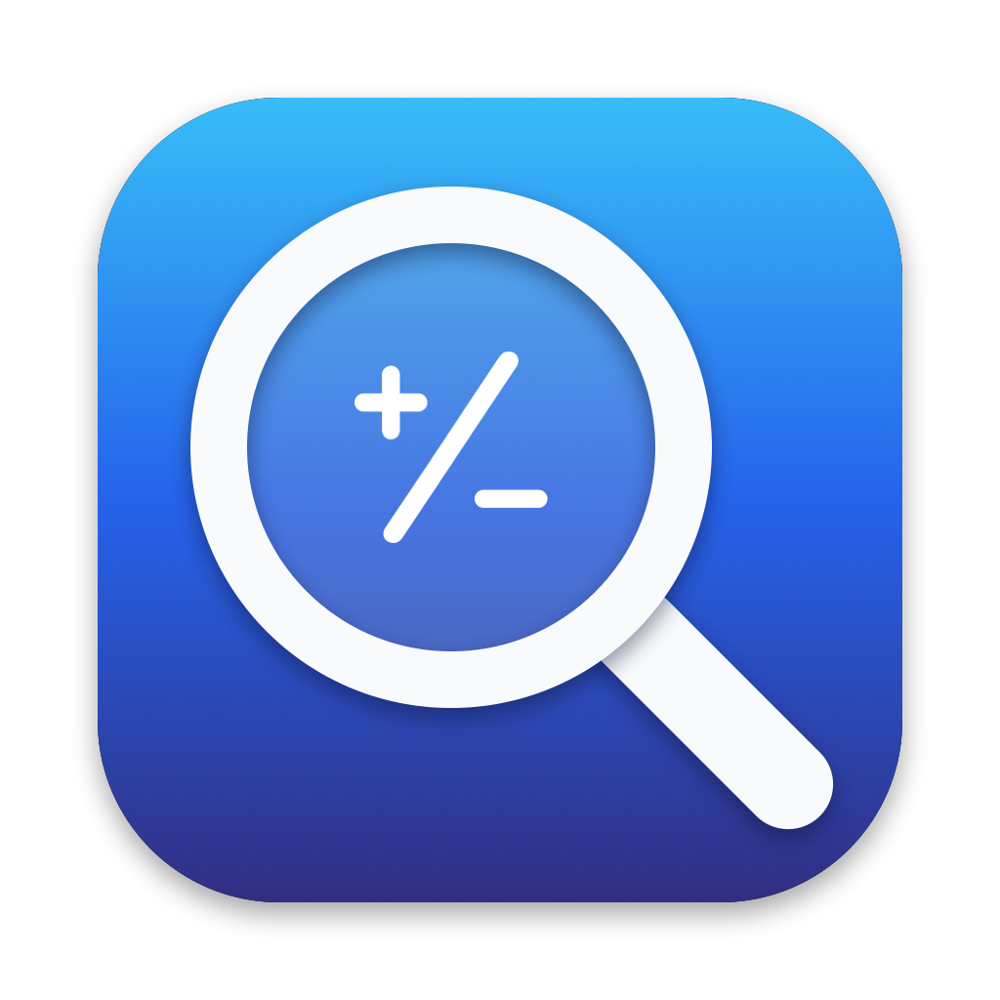
</p>

<h1 align="center">MathPeek</h1>

<p align="center">
  Point at maths anywhere on screen, press a shortcut, and see the answer by the pointer, with the working step by step.<br>
  Free, open source, and light on battery.
</p>

<p align="center">
  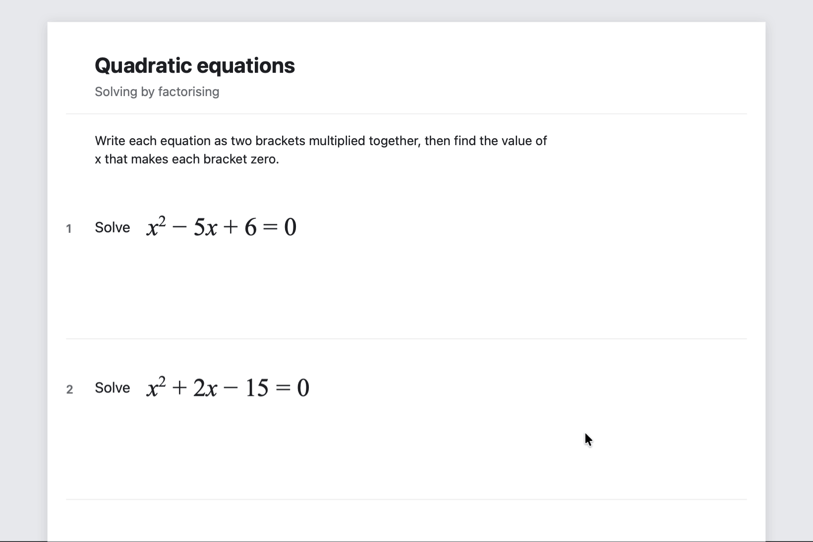
</p>

<p align="center">
  <a href="https://github.com/doom1337hvh/MathPeek/releases/latest"><b>Download</b></a> ·
  <a href="#install">Install</a> ·
  <a href="#in-action">In action</a> ·
  <a href="#settings">Settings</a>
</p>

MathPeek is a small menu bar app for the maths you come across on screen: in a web page, a PDF, a worksheet, a screenshot or a photo. Point at a sum like `12 × (3 + 4.5) =`, an equation like `x² − 5x + 6 = 0`, fractions like `h/6 + 2h/9`, or `d/dx x² sin x`, and press **⌃⌥=**. MathPeek reads what's around the pointer, works it out exactly with its own maths engine, and shows the answer right there in a small bubble. Click the bubble to open the working as a roadmap, from the problem down through each step to the answers, which you can move around, open up and change: a revision tool as much as a calculator. Everything happens on your Mac.

## Features

- **Works anywhere on screen:** web pages, PDFs, documents, screenshots and photos. It reads the screen with macOS's own text recognition, so it doesn't matter which app the maths is in.
- **The answer by the pointer:** a small bubble shows what it read and the answer. Click it for the working, or press ⌘C to copy.
- **Exact answers:** 7/12, 2√3, ln 5/2, with decimals and rounding when you want them.
- **Arithmetic to calculus:** fractions, percentages, surds, algebra, equations, simultaneous equations, sequences, derivatives and integrals.
- **The working as a roadmap:** every step is a stop on a line from the problem to its answers. Open a step to see what was done and why.
- **Visualise a step:** the step written out as you would on paper, with what changes marked.
- **Try it yourself:** write your own working and have each line checked as you write it.
- **Diagrams:** circle theorems, triangles and angles in figures, read from the drawing itself.
- **Questions in words:** many exam-style questions are worked from their wording. Where MathPeek can't be sure, it shows nothing rather than a guess.
- **Practice and history:** another problem like the one you're on, other methods to the same answer, and every answer kept to look back at.
- **Private:** it never connects to the internet. Everything is read and worked out on your Mac.
- **Built for battery life:** no Dock icon and nothing running in the background that doesn't need to. See [Battery](#battery).

Everything above can be switched off or changed in Settings.

### In detail

<details>
<summary><b>What it works out</b></summary>

- **A maths engine, not just a calculator:** exact answers (7/12, 2√3, ln 5/2), with decimals when you want them. It covers:
  - arithmetic with fractions, mixed numbers, powers, roots and percentages (`50 + 10%` is 55, `15% of 80` is 12, `increase 60 by 20%` is 72);
  - algebra: simplifying, expanding brackets, factorising, and adding fractions with letters;
  - equations: linear, quadratic (factorising or the formula, with complex roots), cubics and above by the factor theorem, and exponential, log and trig equations;
  - simultaneous equations: linear ones by elimination, and others like `y = x²; y = x + 2` by substitution;
  - calculus: derivatives with the product, quotient and chain rules; integrals by the standard forms, substitution, by parts and partial fractions; definite integrals;
  - substitution, like `3x + 2 when x = 4`, and functions, like `f(x) = 3x + 2. Find f(4)`;
  - sequences: the nth term of a list like 3, 7, 11, 15 (linear, quadratic or geometric), a term from its number, and which term has a value;
  - remainders of huge numbers, like `2²⁰²⁶ + 3²⁰²⁶` divided by 13, by finding where the powers' remainders repeat.
- **Checks written answers:** point at `12 × 7.5 = 91` and it tells you the answer is 90.
- **Questions in words:** exam-style questions in number, ratio and percentages, algebra, sequences, probability, statistics, graphs, and shapes and measures are worked from their wording, over as many lines as they take, without Apple Intelligence. What the words ask for decides how the answer is given: as a mixed number, to 3 significant figures, in terms of π. It doesn't cover every question, and when it can't be sure of an answer it shows nothing rather than a guess. Other word problems go to Apple Intelligence, which gets some wrong; MathPeek only shows its answer when the maths it wrote comes out as plain numbers, and says what each letter stands for.

</details>

<details>
<summary><b>The working window</b></summary>

- **The working as a roadmap:** click the answer to open it. The problem is at the top, each step is a stop on the line below it showing where it got to, and the line ends at the answers, branching when there are several, like the three roots of a cubic. Drag it to move around, and pinch (or ⌘ and scroll, or ⌘+ and ⌘−) to zoom.
- **Open a step where it is:** click a stop, or use ↑ and ↓, and it unfolds: what was done, the maths, why it works and the mistake to watch out for.
- **Visualise a step:** in an open step, **Visualise** writes the step out as you would on paper: what's done to both sides in blue and what cancels struck through, the part of a sum that's worked out and where its answer goes, like terms put together, brackets multiplied out in a grid, a fraction's top and bottom multiplied by the same number, two equations added in columns. **Graph** shows it as curves instead: an equation's sides before and after, crossing at the same answer. Each stays on for every step you open until you hide it.
- **History:** every answer is kept, newest first and by day. Open it with the clock at the top right of the working window, **History** in the menu, or ⌘Y; click one to open its working again, type to search it (by question, answer or topic: "quadratic", "fractions"), and right-click one to pin it to the top or delete it. It's kept on this Mac only; **Keep a history** in Settings turns it off, and **Clear History** empties it (keeping what's pinned, if you like).
- **Another Like This:** under the answers, a new problem of the same kind with other numbers, chosen so the answers come out as tidily, opened ready to try yourself.
- **Another method:** a quadratic equation can be worked by factorising, by the formula or by completing the square; the methods are listed under the problem, and clicking one shows its steps to the same answers.
- **Copy Image:** copies the working as a picture, the problem, each step and the answer, to paste into notes.
- **Rounding:** an answer that isn't whole can be shown exactly, to 1 or 2 decimal places, or to 3 significant figures, as a question asks; Copy Answer copies it as shown.
- **Following a term:** pick a term and every term of its kind lights up through the working (3x lights 2x and 5x), to follow it as it moves and combines.
- **Click the maths:** click a term or a bracket, in the problem or in a step, to see what it is. The same thing lights up wherever else it appears.
- **Change a number:** pick a term in the problem and its numbers are underlined. Click one and type another (↑ and ↓ go up and down by one, Return puts it in). The whole roadmap is worked out again.
- **Try it yourself:** **Try It Yourself** takes MathPeek's steps away and you write your own working at the stops on the roadmap, a line at a time. Each line is checked as you write it: a right one fills its circle blue and the line runs down to it, a wrong one turns red and says what it gives instead. Stuck, **Hint** names the next step, and **Write It In** writes its line for you. Reaching the answer shows it; **Show Everything** brings back MathPeek's working to compare. Problems that aren't an equation to check (a circle diagram, differentiating) ask for each thing a step works out instead: type it in the box where it goes, Return checks it, and the next one is asked for; **Hint** gives the step's rule, then **Write It In** fills it. Keys under the line type powers, roots, π, × and ÷ and degrees, and the toolbar in the corner writes on the roadmap itself, for rough working next to the steps: pen, highlighter, text (click where it goes), an eraser that rubs out whatever it passes over, and Move for dragging the roadmap about, in white, blue, red or yellow, with **Undo** and **Clear**. ⌘Z or ⌃Z undoes and ⇧⌘Z or ⌃Y redoes (in a box you're typing in, they undo the typing first), M, P, H, T and E pick the tools and 1 to 4 the colours. Scrolling always moves the roadmap, and the writing moves and zooms with it.
- **Check every answer:** click an answer to see it put back into the question. Under the answers the graph shows where each one is, the one picked in yellow, and the **Graph** tab has it too. You can copy the answer, the whole working, or LaTeX.
- **Change it and try again:** edit the problem in the working window, or choose **Type a Problem…** from the menu.
- **Nothing on screen to read:** open MathPeek again while it's running (Spotlight, Finder, Launchpad) and the working window opens as you left it, or with a field to type a problem if there's been none yet.

</details>

<details>
<summary><b>Diagrams</b></summary>

- **Diagrams:** point at a circle-theorem diagram or a triangle and MathPeek reads the drawing itself: the circle, the lines, the points, and which angle or side each number is written by. It then works out what follows, one fact at a time, with the reason for each:
  - Circle theorems: the angle at the centre, angles in the same segment, the angle in a semicircle, cyclic quadrilaterals, a tangent and a radius, the alternate segment theorem, tangents from a point, and the triangles and quadrilaterals inside (radii make isosceles triangles).
  - Triangles: Pythagoras, the sine, cosine and tangent ratios, the sine rule and the cosine rule, for a side or for an angle.
  - Angles in figures of straight lines: parallel lines (alternate, corresponding and co-interior angles), angles on a straight line and round a point, triangles with a line across them, and shapes with up to six sides.
  - It finds the letters in the diagram (x, y, θ); where there are none, every angle or side it can, each in its own tab.
  - It reads the question's words beside a circle diagram too, since exam questions put most of it there: "Angle ABD = 54°", "BC = CD", "PA and PB are tangents", "BOD is a diameter", "Work out the size of angle ACD". The angle asked for comes first.
  - The diagram is drawn again in the working: at the top of the roadmap with what's asked for in blue, and in each step you open with the angles and sides that step works from picked out and the one it finds in blue.
  - Click any other angle in that diagram, or a line when lengths are written on it, and MathPeek works that out instead, in a tab of its own. What's written on the diagram is already known, so it can't be picked.

</details>

<details>
<summary><b>Reading the screen</b></summary>

- **Works anywhere on screen:** web pages, PDFs, documents, images and screenshots. It reads what's on screen with macOS's own text recognition, so it doesn't matter which app the sum is in.
- **The answer by the pointer:** a small bubble shows the sum it read and its answer, then fades away. It stays while the pointer is on it. Click it, or press ⌘C, to copy the answer.
- **Several problems at once:** every separate problem in the area is found and solved. The bubble lists them all, and the working window gives each its own tab. Equations that belong together, with the same unknowns, are solved as simultaneous equations.
- **Reads maths laid out on the page:** a fraction with one thing over another, or a root with a bar over what it's the root of. Text recognition reads lines, so MathPeek finds the bars in the picture, sets each piece down again along one line, and reads that. Apple Intelligence on your Mac can help with what's left and with word problems; it only turns them into maths, MathPeek's engine works out the answer, and anything it writes that isn't on the screen is thrown away. See [Permissions](#permissions). A fraction in tall brackets with a power after it, `(9/16)` to the `−3/2`, is read the same way, and so is a fraction none of whose parts text recognition saw at all, like the `2/5` among the choices of an exam question. A whole number in front of a fraction is a mixed number (`1 2/3`, not 12 over 3), and a root in the top or bottom of a fraction, `3` over `5√x`, is read as a root. A root sign printed with no bar after it (`√3 × √5`, as worksheets print surds) is known by its shape, in a line or inside a fraction.
- **The right problem:** when there are several, it picks the one nearest the pointer, skips plain numbers, and copes with what text recognition gets wrong (× read as x, ∫ as J, √ as V).
- **Powers and bars from the picture:** text recognition can't tell that a power is raised. It reads 2²⁰²⁶ as 22026, x² as x or x', and the bars of |x − 3| as letters. MathPeek finds each character's ink in the picture, sees which sit higher, and reads those again on their own. It knows a slash by its shape too: text recognition often drops the slash after a power, `(x + 3)²/2`, or reads it as a 1. A per cent sign that's read as an 8 is known by its two rings, and ⩾ or ⩽ read as > or < by the extra line under the sign. A times sign read as the letter x between numbers or roots is known by standing clear of the line the digits sit on. If a power can't be read, or there's ink that no character accounts for, it says it can't read that clearly rather than answer a different question.
- **You choose what it reads:** an area around the pointer, sized in Settings, or an area you drag out each time, like a screenshot. **Read an Area…** in the menu does that too.
- **Click a highlight:** while you choose an area the pointer becomes a crosshair, and the problems MathPeek is sure of are highlighted, each outline on its own text. Click one for its answer, or drag as before. Sure means read twice: each problem is read again on its own, enlarged, and has to come out the same, with its powers borne out by the ink. Text too small to make out, and anything that didn't read the same twice, is left alone. So is one number with a dash and another in the middle of a sentence when it could be a range, a pair of years, opening hours, a score or a phone number; `718 − 114`, a bigger number less a smaller one, is taken as a sum.
- **Your own shortcut:** ⌃⌥= to start with; record any other in Settings.

</details>

## In action

Click one to watch it.

<details>
<summary><b>The answer by the pointer</b>: sums, a percentage and fractions, and a written answer that's wrong.</summary>
<p align="center">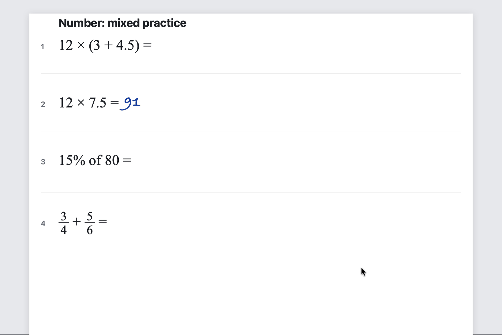</p>
</details>

<details>
<summary><b>Several problems at once</b>: the bubble lists every problem it found, and each gets its own tab.</summary>
<p align="center">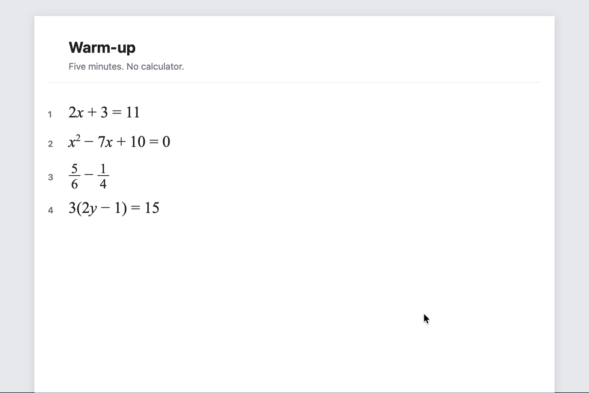</p>
</details>

<details>
<summary><b>The roadmap</b>: each step is a stop on the line, which branches to a cubic's three roots. A quadratic can be worked another way.</summary>
<p align="center">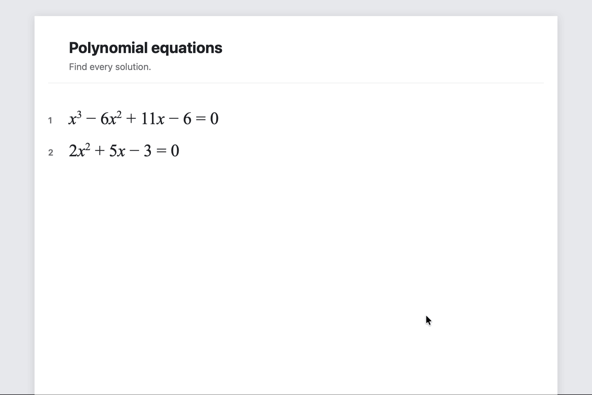</p>
</details>

<details>
<summary><b>Poke at the working</b>: click a term to see what it is and follow it through the steps, click an answer to check it, round it, zoom in and drag the roadmap about.</summary>
<p align="center">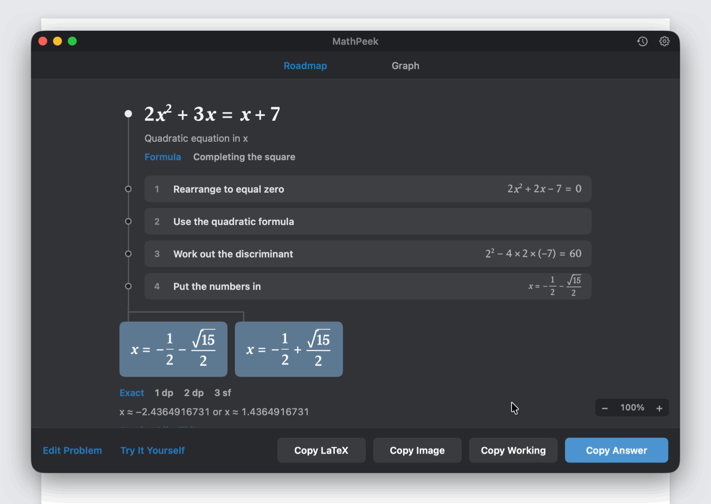</p>
</details>

<details>
<summary><b>Try It Yourself</b>: write your own working a line at a time. Each line is checked as you write it.</summary>
<p align="center">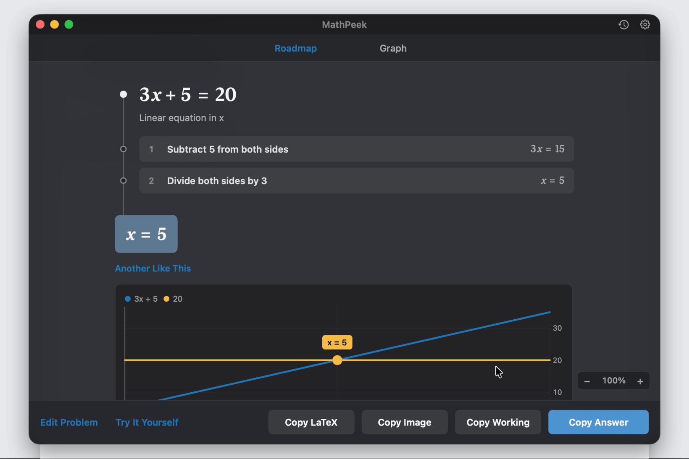</p>
</details>

<details>
<summary><b>Write on the roadmap</b>: in Try It Yourself, work it out by hand with the pen, rub out a slip, highlight the answer and type a note.</summary>
<p align="center">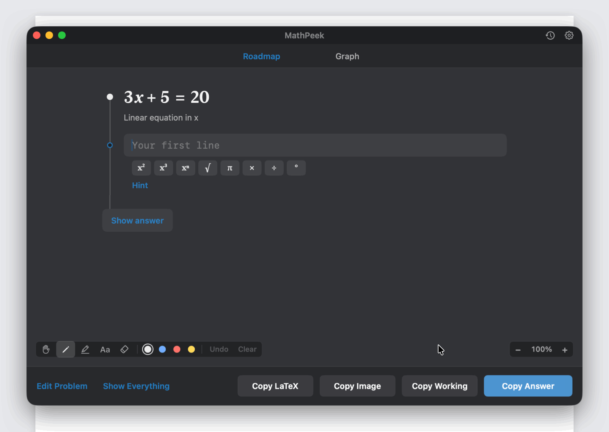</p>
</details>

<details>
<summary><b>Diagrams</b>: a circle-theorem diagram is read from the drawing and worked out, with the diagram drawn again in the working.</summary>
<p align="center">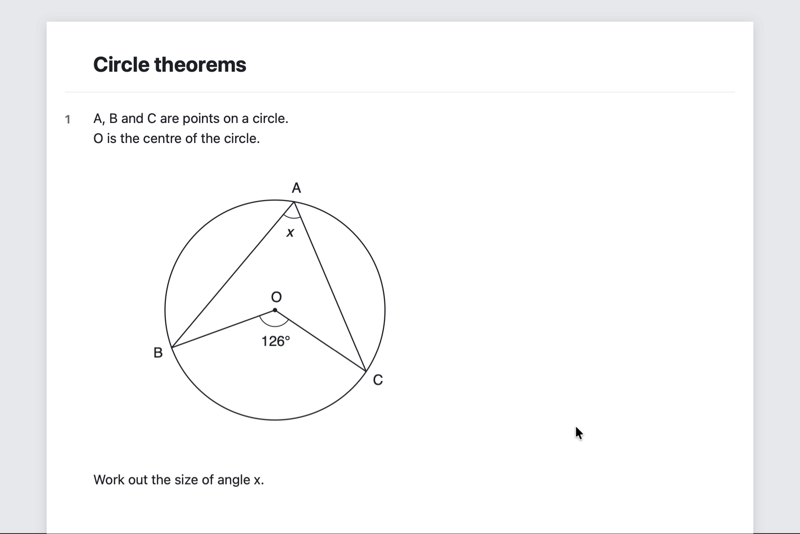</p>
</details>

<details>
<summary><b>Change a number</b>: click a number in the problem, type another, and the whole roadmap is worked out again. Another Like This gives a new one to try.</summary>
<p align="center">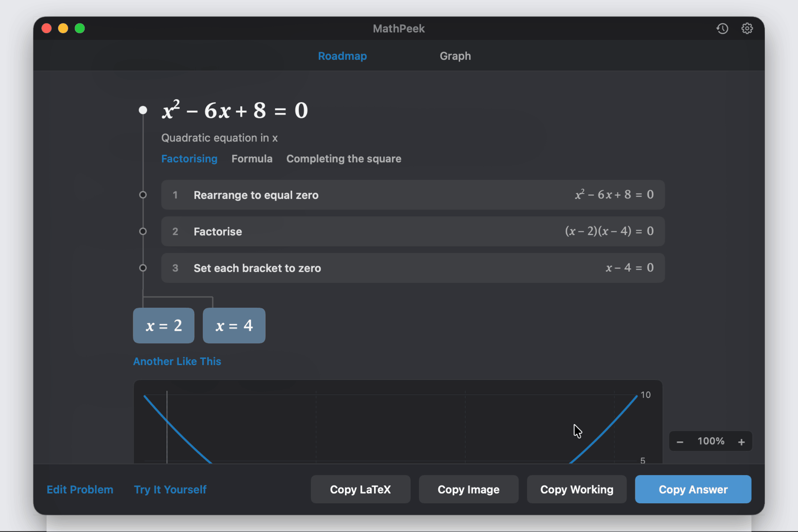</p>
</details>

<details>
<summary><b>History</b>: every answer is kept by day. Type to search it, and click one to open its working again.</summary>
<p align="center">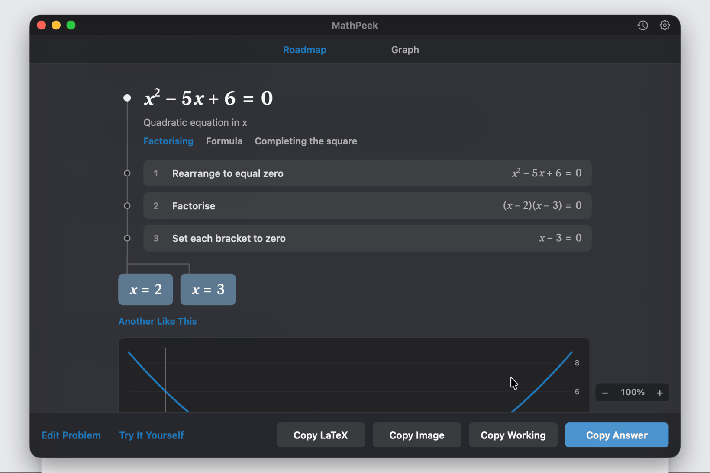</p>
</details>

<details>
<summary><b>Settings</b>: General, MathPeek and About.</summary>
<p align="center">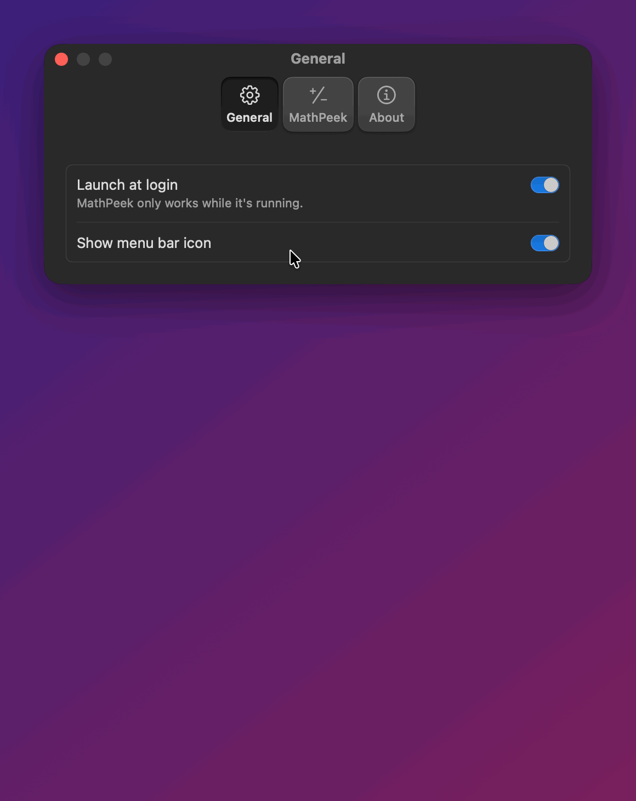</p>
</details>

## Requirements

- A Mac with Apple silicon, running macOS 14 Sonoma or later
- Optional: Apple Intelligence on macOS 27 or later, for word problems and maths MathPeek can't make out itself

## Install

1. Download `MathPeek-<version>.dmg` (or the `.zip`) from the [latest release](https://github.com/doom1337hvh/MathPeek/releases/latest).
2. Drag **MathPeek** into your **Applications** folder. Don't run it from Downloads: macOS runs apps opened there from a temporary copy, and the permissions you give that copy don't stick.
3. Open MathPeek. macOS will say *"Apple could not verify 'MathPeek' is free of malware"*. Click **Done**.
4. Open **System Settings → Privacy & Security**, scroll down to **Security**, and click **Open Anyway** next to *"MathPeek was blocked"*. Confirm with **Open Anyway** and your password or Touch ID.
5. Point at a sum and press **⌃⌥=**. The first time, macOS asks to let MathPeek record the screen (see [Permissions](#permissions)): click **Open System Settings**, turn on **MathPeek**, then click **Quit & Reopen** when macOS asks. Press the shortcut again.

**Why the warning?** Apple only vouches for ("notarizes") apps whose developers pay for an Apple Developer account. MathPeek is a free project and isn't notarized. The source code is all here, and you can [build it yourself](#build-from-source) instead.

**Prefer Terminal?** Instead of steps 3 and 4, run this, then open the app normally:

```bash
xattr -dr com.apple.quarantine /Applications/MathPeek.app
```

**Check your download (optional):** each release lists SHA-256 checksums in `SHA256SUMS.txt`. Compare them with:

```bash
shasum -a 256 ~/Downloads/MathPeek-*.dmg
```

## Updating

Quit MathPeek (menu bar icon → Quit), replace the app in Applications with the new one, and open it. Each new download needs **Open Anyway** once more. Your permissions carry over, because every release is signed with the same certificate. If a release ever can't be, its notes will say so, and you'll need to allow them again.

## Permissions

| Permission | Asked when | What it's for |
|---|---|---|
| **Screen Recording** | The first time you press the shortcut | Seeing the text in the area it reads. It captures only that area, only when you press the shortcut, recognises the text on your Mac and keeps nothing. When you're choosing an area it looks over the whole screen, to highlight the problems on it. |
| **Login Items** | You turn on **Launch at login** | Starting MathPeek when you log in. |

**Apple Intelligence** isn't a permission, but if it's on (in System Settings and in MathPeek's settings), MathPeek asks Apple's on-device model to read maths laid out over several lines and word problems. That model runs on your Mac; MathPeek never uses Apple's cloud model.

**Privacy:** MathPeek never connects to the internet. It has no analytics, no accounts and no update checks. What it reads on screen is used for the answer and then forgotten: nothing is saved or sent anywhere. Your settings stay on your Mac.

## Settings

Open Settings from the menu bar icon, or with the gear at the top right of the working window (⌘, there does the same). If you've hidden the menu bar icon, open MathPeek again while it's running to get that window.

**General:** launch at login, and the menu bar icon.

**MathPeek**
- **Turn on MathPeek** (on): whether the shortcut works. Also in the menu.
- **Shortcut** (⌃⌥=): click it, then press the keys you want, with ⌘, ⌥ or ⌃ (or a function key on its own). Escape cancels; Delete clears it. A warning sign means another app already has it.
- **Area** (Around the pointer):
  - **Around the pointer** reads the sum nearest the pointer within **Width** × **Height**, 700 × 200 points to start with. While you change them, an outline of the area follows the pointer.
  - **An area I drag out** dims the screen when you press the shortcut and highlights the problems it finds. Click a highlight, drag over the sum, or click anywhere else to read around that point. Escape, a right-click or the shortcut again cancels.
- **Angles** (Degrees): for sin, cos and tan. A ° or π in the problem decides for it, and calculus always uses radians. An angle found as an answer is shown in this measure, with the other beside it.
- **Use Apple Intelligence** (on, where available): read word problems, and maths MathPeek can't make out itself, with Apple's on-device model.
- **Keep it on screen for** (5 seconds): how long the answer stays, unless the pointer is on it. Click it for the working; ⌘C copies the answer.
- **Window transparency** (55 %): how much of what's behind shows through the working window. 0 % is solid.
- **Keep a history** (on): every answer, to look back through in the working window. It's kept in a file on this Mac and nowhere else.
- **Screen Recording:** whether MathPeek may see the screen, with a button to the right page of System Settings.
- **Show what it sees** (off), under Debug: each time you press the shortcut, MathPeek draws what it made out over the screen. Every character gets a box (powers orange, slashes green, bars purple), every line it read an outline, and any diagram its circle and lines. A sum it found but left out has a dashed yellow outline and the reason. Point at a line to see how it was read. With **Around the pointer** it goes when the answer's bubble does, or when you press the shortcut again, and while it's on every bubble stays at least as long as **Keep it on screen for** says; with **An area I drag out** it stays while the screen is dimmed.

The menu bar menu has **Turn On MathPeek**, **Read an Area…** (drag out an area whichever way the shortcut works), and **Type a Problem…** (opens the working window to type one in).

**About:** the version, a link here, and the licences.

## Battery

MathPeek does nothing until you press the shortcut: no timers, no polling and nothing watching the screen. The shortcut is registered with macOS, which costs nothing while it waits. At launch it warms up text recognition once, so the first press is as quick as the rest. Each press takes one picture of the area and recognises its text once, in a few hundredths of a second; choosing an area reads each whole screen once and then the problems it found once more, which takes around half a second. Only word problems, and maths it can't make out itself, also ask Apple Intelligence, which takes a second or two.

## Troubleshooting

- **"No maths found":** point closer to the maths, make the area bigger in Settings, or use **Read an Area…** to drag over just the problem. Most word problems need **Use Apple Intelligence**, and it can't turn every word problem into maths.
- **"Can't read that clearly":** there's maths there, but part of it is too small or too close together to make out, or it read differently the second time. Zoom in (⌘+ in most apps) and try again. It also says this for a power whose minus sign has run into its digit, and for a fraction that the edge of the area cuts through: move the pointer so the whole fraction is inside, or make the area taller in Settings.
- **It read the wrong thing:** text recognition can misread small or unusual text. The bubble shows what it read above the answer; click it, choose **Edit Problem**, fix it, and press **Solve**. Zooming in (⌘+ in most apps) helps too.
- **A diagram isn't read:** it needs the whole drawing in view, lines drawn clearly, and labels big enough to read; zoom in on small ones. Circle diagrams need the full circle, drawn round: exam papers often draw it slightly squashed, and those aren't made out yet. Lengths are only read on a single triangle.
- **Something isn't highlighted, and I want to know why:** turn on **Show what it sees** in Settings and press the shortcut again. A dashed yellow outline says why a sum was left out; no outline at all means MathPeek read the line but found no sum in it, and pointing at the line shows how it was read.
- **"Can't work that out yet":** MathPeek read it but its engine doesn't cover it. Try writing it another way with **Edit Problem** in the working window.
- **Nothing happens when I press the shortcut:** check that MathPeek is on (its menu bar icon is greyed out when it's off). If Settings shows a warning sign by the shortcut, another app has it: record a different one.
- **It asks for Screen Recording again after I allowed it:** macOS only lets MathPeek see the screen once it has been reopened. Quit it from the menu bar and open it again. If it still asks, remove MathPeek from the list in **System Settings → Privacy & Security → Screen & System Audio Recording** with **−**, then press the shortcut to be asked afresh.
- **macOS asks whether MathPeek can keep seeing the screen:** macOS checks this every so often for every app with Screen Recording. Choose **Allow** to keep using MathPeek.

## Uninstall

Quit MathPeek (menu bar icon → Quit), delete it from Applications, and optionally remove its settings:

```bash
defaults delete io.github.doom1337hvh.MathPeek
```

You can also remove it from the lists in **System Settings → Privacy & Security**.

## Build from source

You need the Xcode Command Line Tools (`xcode-select --install`); Xcode itself isn't needed.

```bash
git clone https://github.com/doom1337hvh/MathPeek.git
```

```bash
cd MathPeek && scripts/build.sh
```

The app is built to `build/MathPeek.app`. `scripts/build.sh --install` also copies it to `~/Applications` and opens it there. The menu bar icon, Settings window and build scripts come from [AppShell](https://github.com/doom1337hvh/AppShell), which Swift Package Manager fetches on the first build.

Optionally, run `scripts/create-signing-cert.sh` once first. It makes a local code-signing certificate, so the permissions you grant survive rebuilds; otherwise each build is signed ad hoc and macOS treats it as a new app. To make a release, see [docs/RELEASING.md](docs/RELEASING.md).

### How it works

- **The shortcut** (`Hotkeys.swift`) is registered with Carbon's `RegisterEventHotKey`, which works in every app without a permission. While an answer shows, ⌘C is registered the same way, to copy it.
- **The area** (`MathReader.swift`, `AreaPicker.swift`) is a rectangle centred on the pointer, or one you drag out on a dimmed overlay. The overlay is a non-activating panel, so the app you're in keeps the focus. While it's up, each screen is read once and the problems MathPeek can work out on its own are outlined (`ScreenReader.spot`); a click on one shows the answer it already has. macOS ignores a background app that sets the cursor, so the crosshair needs the window server's `SetsCursorInBackground` setting, which isn't a public one; it's looked up when needed, and without it the pointer just stays an arrow.
- **Reading it** (`ScreenReader.swift`): ScreenCaptureKit takes a picture of just that area, leaving out MathPeek's own windows (the capture filters are kept between presses). Vision recognises the text on the Mac, with language correction off so it doesn't turn maths into words; it's warmed up at launch, because its first run can take many seconds.
- **Powers and bars** (`RaisedText.swift`): Vision gives the characters but not their height, so a power comes back as ordinary digits, as a stray mark, or not at all. `Ink` finds each character's marks in the picture and the line they sit on; `LineMender` matches them to what Vision read, word by word, cuts out the raised ones, and has Vision read those again, enlarged, each after "N = " so it has a line to read. A slash is a thin straight stroke that leans further than any slanted letter does (`Ink.lean`): one Vision left out is written back in, and one it read as a 1 is put right. The picture is given a margin first, because Vision misreads text that runs up to the edge.
- **Fractions and roots** (`Flattener.swift`): the ink shows where a fraction's bar is, with something over it and under it, and where a root's bar covers what's under it. Each piece is cut out and drawn on a sheet, one to a row after a couple of words (Vision reads a short piece of maths on its own as nonsense), the sheet is read, and the line is put together again with the signs between the pieces written in. A short bar with clear room over it is taken for a fraction wherever it is in the picture, unless it is one of a stack of rules (a table). Tall round brackets are known by their shape (`Ink.bracket`) and written in; a small fraction set high after the line is a power. A root found inside the top or bottom of a fraction is written into that part (`3/(5√(x))`); a fraction under a root is still left alone. A search area that cuts through a bar is widened until the bar is whole. A root sign with no bar (`Ink.isRootSign`: a short arm from part-way down, a point at the foot, a long arm to the top right) is written in as a sign, and the digits beside it are read without it. A fraction that the edge of the area cuts through is not trusted.
- **Diagrams** (`DiagramReader.swift`): text recognition reads "126°" and "33°" but not which angle each is in, so the drawing is found in the picture. A drawn line is a thin stroke unlike what's either side of it, whatever the background; a circle is the ring of stroke that fits best (three points at random give a circle, and the one with ink most of the way round wins); straight lines are found by which line the most ink lies along, and kept only if they're held at both ends, on the circle, at its middle or where lines meet, which leaves out the strokes of letters. A triangle is three lines that meet each other. Arcs across angles and the little squares for right angles are taken out, and what's left is writing: each label is drawn on a sheet after "N = " and read, and goes to the angle or side it sits by. `Engine/CircleTheorems.swift` turns the diagram into facts (every angle is made of the angles between neighbouring lines at a point) and applies them until nothing more follows; `Engine/Triangles.swift` does the same with sides and angles. A reading far from how the diagram is drawn, or two numbers in one angle, gives no answer.
- **Finding the problem** (`ProblemFinder.swift`) picks the maths out of each line: the whole line if it's a problem ("Solve 2x + 3 = 11"), or the runs of maths between words. It fixes common misreadings and leaves out question numbers and labels. The problem nearest the pointer wins.
- **Being sure** (`ScreenReader.confirmed`): every problem is cut out with its line, drawn enlarged on a sheet and read again. Text recognition makes different mistakes at a different size, so what reads the same twice is right; where the two differ a third reading at another size decides, and if that doesn't agree with the first there's no answer. Powers are read wrongly at any size, so for those the ink has the say: a reading with ink left over, a letter standing taller than the capitals, a digit wider than it's tall, or the same shape read as two different characters, isn't trusted.
- **Apple Intelligence** (`Tutor.swift`), when it's on, turns word problems into equations and reads maths from the picture when nothing else could, with Apple's on-device model (FoundationModels). It only ever writes maths; it doesn't answer. It also makes things up (shown a circle with an angle marked 56°, it wrote an equation with 90 and 180 in it), so every number in what it writes has to be one that was read from the screen.
- **The engine** (`Engine/`) works with exact fractions, falling back to decimals only when it has to:
  - `Parser.swift` reads the problem;
  - `Simplify.swift` keeps expressions in a standard form;
  - `Polynomial.swift` handles cancelling, factorising and roots;
  - `Solver.swift` does equations and simultaneous equations;
  - `Calculus.swift` does differentiation and integration;
  - `Modular.swift` finds remainders, bringing huge powers down by the cycle of their remainders;
  - `Sequences.swift` reads questions about sequences and finds the nth term of a list;
  - `Engine.swift` handles the rest and writes the working a teacher would show;
  - `Format.swift` writes it all out as text and LaTeX.
- **Several problems** (`ScreenReader.swift`): every reading of every line is gathered, overlapping ones give way to the longest, and question numbers and wide gaps separate problems. Besides the one nearest the pointer, only clear maths is kept, so dates and page numbers aren't. Equations with the same unknowns, as many as there are unknowns, are grouped as simultaneous equations.
- **The answer** (`AnswerBubble.swift`) is a dark, semi-transparent panel by the pointer that doesn't take the focus. Clicking it opens the working (`LearnWindow.swift`): a window with a see-through backdrop (an `NSVisualEffectView` under a dark tint) and tabs along the top, where Swift Charts draws the graph.
- **The roadmap** (`RouteView.swift`) lays the problem, steps and answers out along a line. Zooming multiplies every size rather than scaling the picture, so the text stays sharp. `MathView.swift` draws the maths as it's written on paper, and keeps track of where each thing drawn comes from in the expression, so a click can pick a term or change a number; `Engine/ProblemEdit.swift` puts the new number into the problem. `Engine/Insight.swift` says what each part is, why each step works, and checks each answer.

```
Sources/MathPeek/
  main.swift, AppDelegate.swift   app lifecycle, menu bar menu, Settings tabs
  MathReader.swift                the shortcut pressed: area, reading, answer
  ScreenReader.swift              screen capture, text recognition, choosing the problem
  ProblemFinder.swift             the maths in a line of text
  Tutor.swift                     Apple Intelligence: pictures and word problems into maths
  Engine/                         the maths engine: parser, simplifier, solver, calculus,
                                  working, text and LaTeX
  AnswerBubble.swift              the bubble by the pointer
  RaisedText.swift                finding powers from the ink in the picture, and checking a reading against it
  Flattener.swift                 fractions and roots laid out along one line to be read
  DiagramReader.swift             circle diagrams and triangles read from the picture
  LearnWindow.swift               the working window: its state, tabs and graph
  RouteView.swift                 the roadmap: steps and answers along a line
  DiagramView.swift               a diagram drawn again in the working, with a step's angles picked out
  StepVisual.swift                a step written out with what was done to it marked
  Explain.swift                   what a picked part of the maths is, said about this problem
  History.swift, HistoryView.swift  the answers given before, kept on this Mac, and the list of them
  Practice.swift                  another problem like the one showing, with other numbers
  Methods.swift                   other ways to a quadratic's answers: the formula, completing the square
  WorkingSheet.swift              the working laid out on one page, for Copy Image
  Checker.swift, LineInput.swift  your own working checked line by line
  RoadmapInk.swift                keys for powers and roots, and the tools for writing on the roadmap
  StepPicture.swift               a graph of what one step did: curves, lines, number line, area, fraction bars
  MathView.swift                  drawing maths, and what clicking it picks
  AreaPicker.swift                dragging out an area; the outline shown while sizing it
  Seen.swift, SeenOverlay.swift   the debug view: what was made out, drawn over the screen
  Hotkeys.swift                   global shortcuts and the shortcut recorder
  Permissions.swift               Screen Recording
  Preferences.swift, SettingsView.swift
scripts/                          build, release, signing certificate, icon
```

## License

MathPeek is released under the [MIT License](LICENSE).
